# nim-compute-sandbox-tui

[](https://github.com/danindiana/nim-compute-sandbox-tui/actions/workflows/verify.yml)

A small, working **Nim REPL that runs Python, JavaScript and SQL** in subprocesses with a timeout, an
**egress proxy with credential injection**, plus an **independent audit** of an AI agent's attempt to "research and reproduce Perplexity's compute sandbox".

> **Read this first.** This repo is **not** a reproduction of Perplexity's sandbox, and it does not claim to be.
> The audit found that the agent's "Perplexity API spec" contains no Perplexity source material. What *is*
> here: a verified list of what Perplexity has actually published, a corrected copy of the agent's notes, and
> a tool that genuinely executes code.

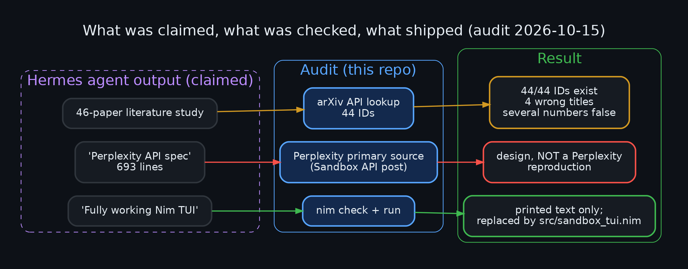

## Contents

| Path | What it is |
|---|---|
| [`src/sandbox_tui.nim`](src/sandbox_tui.nim) + [`src/sandbox_core.nim`](src/sandbox_core.nim) | The REPL / one-shot CLI and the shared execution core (Nim 2.x, stdlib only) |
| [`src/sandbox_mcp.nim`](src/sandbox_mcp.nim) | MCP stdio server: `run_code`, `list_gateways`, `list_sessions`; delegates execution to the sandbox container |
| [`src/egress_proxy.nim`](src/egress_proxy.nim) | Egress proxy: gateway aliases with credential injection, CONNECT allowlist (Nim, `-d:ssl`) |
| [`config/rules.example.json`](config/rules.example.json) | Proxy rules template (placeholders only) |
| [`AUDIT.md`](AUDIT.md) | Full audit: arXiv ID/title check, claim-vs-abstract table, Perplexity grounding, code triage |
| [`research/`](research/) | The agent's original notes with corrections applied (kept for transparency, **unverified**) |
| [`audit/check_papers.py`](audit/check_papers.py) | Re-runnable arXiv title/ID checker; `audit/original/` holds the agent's uncorrected notes |
| [`diagrams/`](diagrams/) | 15 dark-theme Graphviz diagrams (`.dot` + `.png` + `.svg`) |
| [`tests/smoke.sh`](tests/smoke.sh) | CI smoke test over all three languages, the network guard and the timeout |
| [`deploy/isolated/`](deploy/isolated/) | Isolated deployment: `up.sh`, `verify.sh` (18 checks), `down.sh` (rollback), demo-rules generator |
| [`tests/hardening_test.py`](tests/hardening_test.py) | 21 checks: process-group kill, rlimits, scrubbed env, sessions, quota, JSON CLI, live streaming |
| [`tests/mcp_test.py`](tests/mcp_test.py) | 23 checks for the MCP server (protocol, validation, gateway, secret scan) |
| [`tests/proxy_test.py`](tests/proxy_test.py) + [`mock_upstream.py`](tests/mock_upstream.py) | 28 end-to-end proxy checks (injection, rejection cases, redaction, tunnel, TUI integration) |
| [`render.sh`](render.sh) | Re-renders every diagram |

## Background

A local-LLM agent (Hermes Agent running in a Docker sandbox) was asked to research and reproduce Perplexity's
compute sandbox in Nim with a TUI. It reported a finished, "fully working" application and a 46-paper
literature study. An operator asked for that work to be double-checked. This repo is the result, and
the one component that survived scrutiny — after being rewritten — is the REPL below.

## The tool: `sandbox_tui`

```text
┌──────────────────────────────────────────────────────────┐
│ Compute Sandbox - Nim TUI                                │
│ python | js | sql   timeout 10s   net off (soft guard)   │
└──────────────────────────────────────────────────────────┘
python> print(6*7)
... .
────────────────────────────────────────────────────────────
42
────────────────────────────────────────────────────────────
ok  (0.03s)
```

Type code (multiple lines allowed); a line containing only `.` runs it.

| Command | Effect |
|---|---|
| `:lang python\|js\|sql` | Switch language (python3, node, sqlite3) |
| `:net off\|proxy\|on` | **off** (default): no network; **proxy**: only the egress proxy; **on**: unrestricted. off/proxy use a soft guard (see limits) |
| `:gateways` | List the proxy's gateway alias names (never secrets) |
| `:timeout S` | Wall-clock timeout, 1–600 s (default 10) |
| `:limits [fsize\|nofile\|procs\|cpu N]` | Show or change resource limits |
| `:session NAME` / `:ws` / `:wipe` | Switch session (own dir, `HOME`, sql db) / list sessions and sizes / clear the current one |
| `:history` / `:show N` / `:rerun N` | Review and repeat the last 50 runs |
| `:clear` | Discard pending (un-run) input |
| `:help`, `:quit` | Help / exit (Ctrl+D and Ctrl+C also exit) |

### Build and run

```bash
# needs: nim >= 2.0, python3; node and sqlite3 for those languages
nim c -d:release -o:src/sandbox_tui src/sandbox_tui.nim
cd src && ./sandbox_tui
tests/smoke.sh        # from the repo root: languages, net guard, timeout
python3 tests/hardening_test.py   # process-group kill, limits, sessions, JSON CLI, streaming (21 checks)
```

### How it works

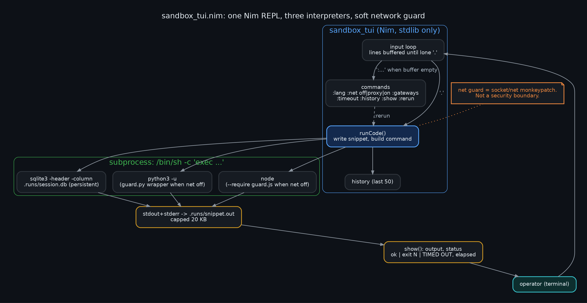

- Each run writes the snippet into its **session directory** (`.runs/sessions/<name>/`, default session `default`) and starts
  `/bin/sh -c 'cd <session> && exec prlimit ... setsid env -i ... <interpreter>'`. Using `exec` means signals hit the interpreter itself.
- **Resource limits** (`prlimit`): CPU seconds (timeout + 5), single-file size (50 MB), open files (256), address space 2 GB for
  python/sqlite3. Node/WebAssembly reserve many GB of *virtual* memory (`fetch` crashes under an address-space cap), so node gets a 512 MB
  V8 heap cap (`--max-old-space-size`) instead. `:limits` shows and adjusts them.
- **Timeout kills the whole process group** (`setsid` makes the interpreter a group leader; `kill(-pid, SIGKILL)`), so child processes die
  with it, and anything a finished run leaves running in the background is reaped too. A timeout is now recorded explicitly, not inferred.
- **Live output:** the output file is polled while the child runs and new bytes are printed immediately (capped at 20 KB total).
- **Sessions:** `:session NAME` switches; each session has its own cwd, `HOME`, files and `session.db` (**SQL** uses `sqlite3` against it,
  so tables survive between runs, a small analogue of a persistent session filesystem). `:ws` lists sizes, `:wipe` clears one, and a soft
  50 MB quota warns after a run that exceeds it (it does not delete or block).
- **Network off** (default) prepends a guard: Python patches `socket.connect/connect_ex/getaddrinfo`; Node patches
  `net.Socket.prototype.connect` and `dns.lookup`. In **proxy** mode the same guards allow connections only to the proxy address.
- Snippets run under `env -i` with just `PATH`, `HOME` and `LANG` (plus proxy variables in proxy mode), so the TUI's own environment
  variables (API keys etc.) are not visible to them.
- **One-shot CLI** for scripts and the planned MCP wrapper: `sandbox_tui --run LANG [--timeout S] [--net off|proxy] [--session NAME] [--dir DIR]`
  reads code on stdin and prints one JSON object (`status`, `exit_code`, `timed_out`, `secs`, `output`, `truncated`, `session`,
  `quota_warning`). `--net on` is deliberately not accepted there. Also `--sessions` and `--gateways`.

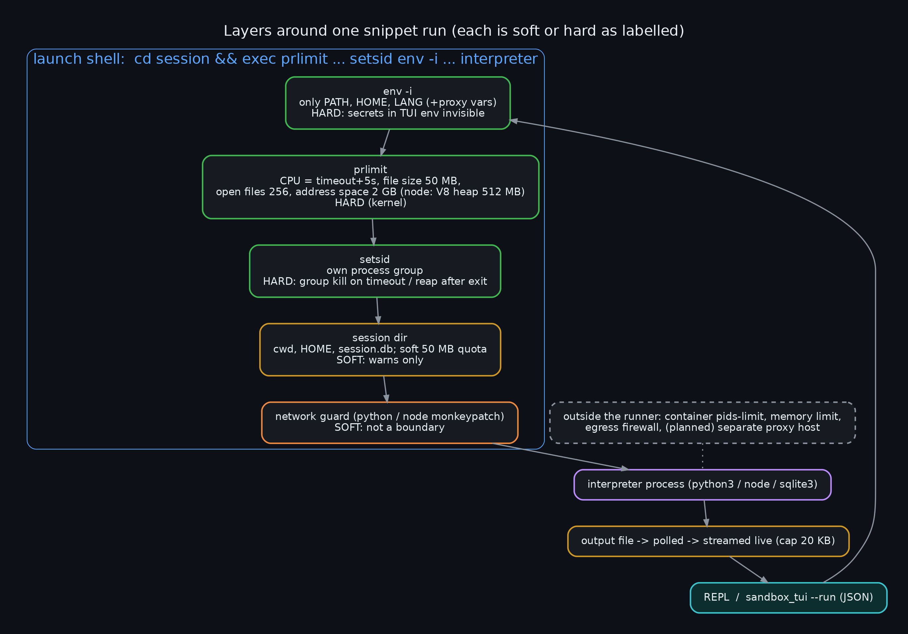

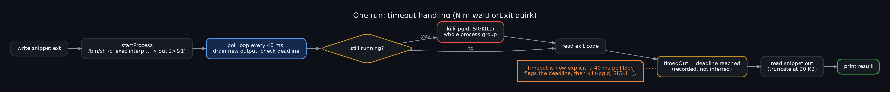

### Known limits (please read)

- **The network guard is not a security boundary.** It is a monkeypatch; code can bypass it (`ctypes`, subprocesses,
  other runtimes). Real isolation must come from the environment (container, network policy, VM). In the author's
  environment `unshare -rn` is blocked by seccomp, so per-run network namespaces were not an option.
- The REPL itself provides **no other isolation**: runs share the working directory and user of the TUI.
- Scripts get no stdin (`/dev/null`). Output over 20 KB is truncated.
- **No process-count limit by default.** `RLIMIT_NPROC` is counted per real uid across the *whole host* and threads count, so in a container
  that shares a uid with a busy host user any realistic cap breaks node (it needs ~10 threads). The container runtime's pids-limit is the real
  fork-bomb bound; `:limits procs N` opts in to a raw cap.
- Resource limits are per run, not per session; the quota is advisory.
- **Not implemented:** per-session pods, a FUSE filesystem, TLS interception (see below for why).

## The egress proxy

Perplexity's post describes sandboxes with no direct network whose outbound traffic goes through a proxy *outside* the sandbox that
matches domains and injects credentials. `src/egress_proxy.nim` models that.

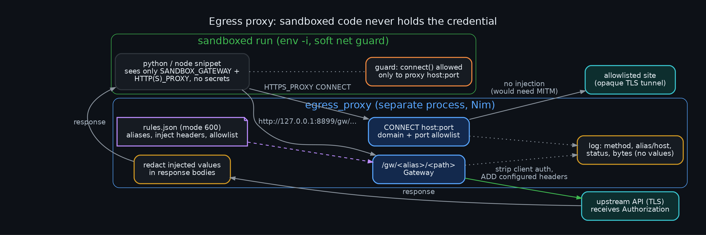

**Two paths:**
1. **Gateway** — code calls `http://127.0.0.1:8899/gw/<alias>/<path>` (the URL is in `$SANDBOX_GATEWAY`). The proxy calls the alias's
   configured upstream over verified TLS, **drops any client-supplied `Authorization`/`Cookie`/`X-Api-Key`/`Host`**, adds the configured
   headers, and returns the response. Any injected value that appears in the response body is redacted.
2. **CONNECT** — `HTTPS_PROXY` works for allowlisted domains and ports only. It is an opaque tunnel with **no injection**: injecting into
   HTTPS this way would need TLS interception (a custom CA in every runtime's trust store), which this project deliberately does not do.

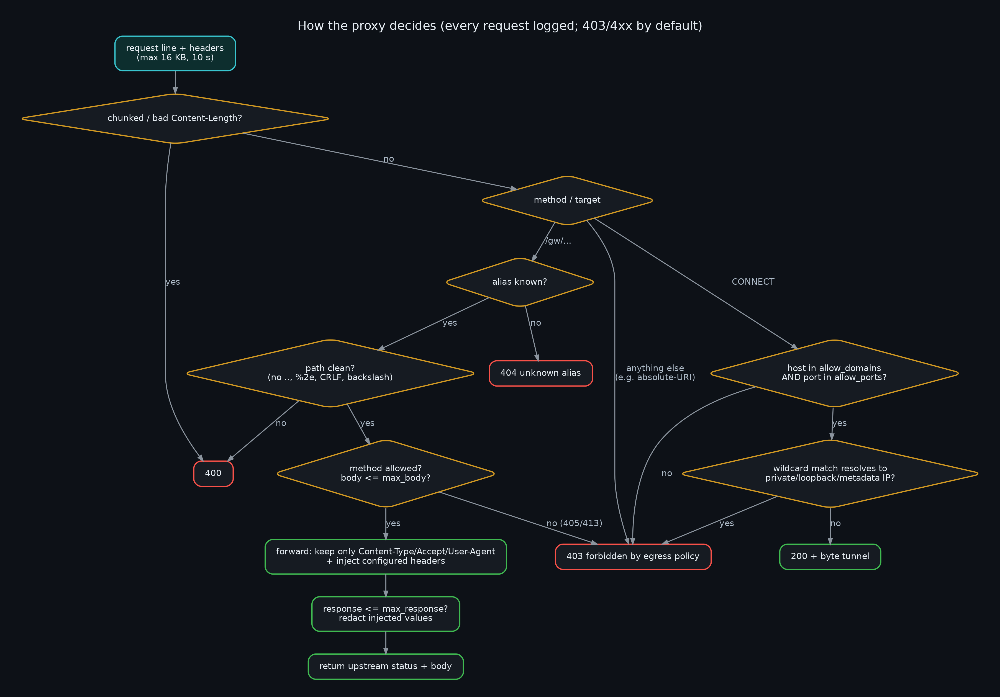

**Hardening in the code:** rules file must be mode 600 or the proxy refuses to start; upstreams must be `https` (plain `http` only for
loopback test servers); path traversal (`..`, `%2e`, `%2f`, backslash, CR/LF), chunked requests, oversize bodies/responses, disallowed
methods and header floods are rejected; redirects are not followed (they could carry the credential elsewhere); wildcard allowlist
matches that resolve to private/loopback/link-local/metadata addresses are refused; logs record method, alias/host, status and size
only — never header values, bodies or query strings.

**Rules file** (`~/.config/sandbox-proxy/rules.json`, see [`config/rules.example.json`](config/rules.example.json)):
```json
{ "listen": "127.0.0.1:8899",
  "allow_domains": ["pypi.org", "*.githubusercontent.com"], "allow_ports": [443],
  "gateways": { "example-api": { "upstream": "https://api.example.com/v1",
                                 "inject": { "Authorization": "Bearer <token>" },
                                 "methods": ["GET", "POST"] } } }
```
```bash
nim c -d:ssl -d:release -o:src/egress_proxy src/egress_proxy.nim
chmod 600 ~/.config/sandbox-proxy/rules.json
src/egress_proxy                       # or: src/egress_proxy --listen 127.0.0.1:9000 path/to/rules.json
# in sandbox_tui:   :net proxy   then   :gateways
# python:  urllib.request.urlopen(os.environ["SANDBOX_GATEWAY"] + "/example-api/items").read()
```

### What the proxy does and does not protect

The mechanism is only as strong as the boundary around it, so there are two deployments:

1. **Single container (demo, `tests/proxy_test.py`):** sandboxed code runs as the same user as the proxy and can read `rules.json`, so the
   credential is **not** protected there. It demonstrates the mechanism and API shape with canary secrets.
2. **Isolated deployment (`deploy/isolated/`, tested):** the proxy and the runner are separate containers.
   - `sbx-iso` is a `docker network create --internal` network: no gateway, no internet, no route to the host or LAN.
   - `sbx-runner` (where code runs) is attached **only** to `sbx-iso`, with a read-only root filesystem, all capabilities dropped,
     `no-new-privileges`, and memory/pids limits. The rules file is not mounted into it.
   - `sbx-proxy` is on `sbx-iso` (listening only on that address, so other networks cannot call its gateways) and on an existing egress network
     for its own outbound traffic. The rules file is mounted read-only into this container only.
   - Only docker commands are involved: no iptables, UFW or systemd changes. `./up.sh`, `./verify.sh`, `./down.sh` (rollback).

`deploy/isolated/verify.sh` (18 checks, all passing) shows from inside the runner, using raw Python that bypasses the soft guard: no internet,
no DNS, no route to the docker host or the LAN, the proxy port reachable, no `rules*.json` anywhere in the filesystem, read-only rootfs; through
the proxy: an HTTPS gateway call reaches `example.com`, a non-allowlisted domain is refused, the injected value is invisible to code and absent
from output and from the proxy log; an existing sandbox container is unaffected and cannot reach the proxy; everything still holds after
restarting both containers. `tests/mcp_test.py --container sbx-runner --example-gateway` passes end to end (MCP -> runner -> proxy -> HTTPS).

**Remaining caveats of the isolated deployment:** the network isolation is now enforced by the kernel and docker (no route), but the in-runner
guard is still a monkeypatch; the runner and proxy share the host kernel (a kernel or docker escape defeats it); anyone who can read the host's
rules file or use the docker socket can read the credential; the proxy's own outbound path is the egress network's policy (the verification used
`hermes-sbx`, which blocks LAN and metadata but allows the internet); the verification used a rules file of **fake** values; behavior after a docker
daemon restart or host reboot was not tested (the containers use `--restart unless-stopped`); IPv6 was not examined.

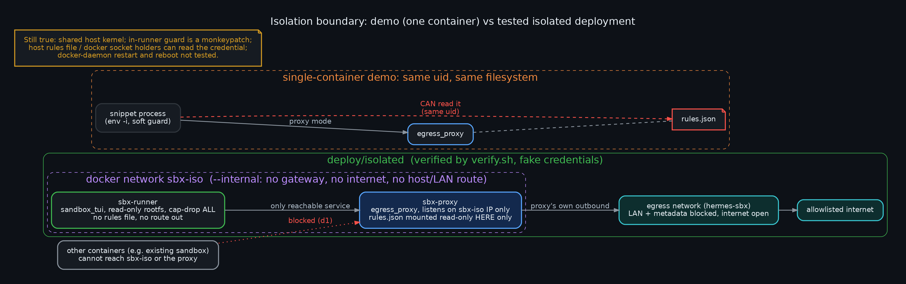

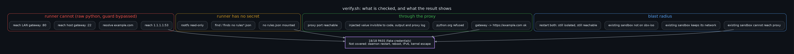

`tests/proxy_test.py` (28 checks, run in CI) covers: injection reaches the upstream; forged client auth is overridden; unknown alias / disallowed
method / traversal / CRLF / oversize / chunked / absolute-URI are rejected; secrets are redacted from responses; non-allowlisted hosts and ports
are refused on CONNECT while an allowlisted tunnel works without injection; the secret never appears in the proxy log or TUI output; a TUI
environment canary is invisible to snippets; direct connects to non-proxy hosts are blocked in proxy mode and everything is blocked in off mode.
Real-TLS behavior (gateway to an `https://` upstream, CONNECT through the proxy) was additionally checked manually against `example.com`, and in the isolated deployment by `verify.sh`.

## MCP server

`src/sandbox_mcp.nim` exposes the sandbox to MCP clients (Hermes, Claude Code, anything that speaks MCP over stdio).

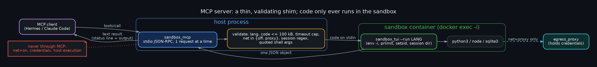

- **Tools:** `run_code(lang, code, timeout_s?, net?, session?)`, `list_gateways()`, `list_sessions()`.
- **The MCP process never executes code itself.** It runs `docker exec -i <container> sandbox_tui --run ...` so snippets execute inside the sandbox
  container, not on the machine hosting the MCP server (an MCP server on the host would otherwise be an unsandboxed code-execution tool).
  A `--local` runner exists for tests/CI only.
- **Guard rails:** `net` accepts `off|proxy` only (`on` is refused); code ≤ 100 kB; `timeout_s` capped by `--max-timeout` (default 60);
  session names validated; container/path/proxy arguments are validated and every shell argument is quoted. Requests are handled one at a time.
- **No credentials pass through it.** Gateways appear only as alias names; the egress proxy injects the secret out-of-band. The tests scan every
  byte the server sends for a canary secret.
- Code errors and timeouts are normal *results* (`isError: false`, with a `status:` line and the traceback); `isError: true` is reserved for
  invalid arguments and runner failures.

```bash
nim c -d:release -o:src/sandbox_mcp src/sandbox_mcp.nim
# register (examples; adjust paths):
hermes mcp add sandbox --command /path/to/sandbox_mcp --args --container <sandbox-container> --exec-path /path/in/container/sandbox_tui --workdir /path/in/container
claude mcp add sandbox -- /path/to/sandbox_mcp --container <sandbox-container> --exec-path /path/in/container/sandbox_tui
python3 tests/mcp_test.py                                   # local runner (what CI runs)
python3 tests/mcp_test.py --container <name> --exec-path P  # same checks through docker exec
```
`tests/mcp_test.py` (23 checks) covers the handshake, notifications, tool schemas, ok/error/timeout/js/sql/session behavior, every validation
refusal, JSON-RPC error codes, malformed input, gateway calls through the proxy, and the secret scan. It also passed against a live sandbox
container through `docker exec`.

## The audit

Method (all checks reproducible; nothing here relies on the agent's own summaries):

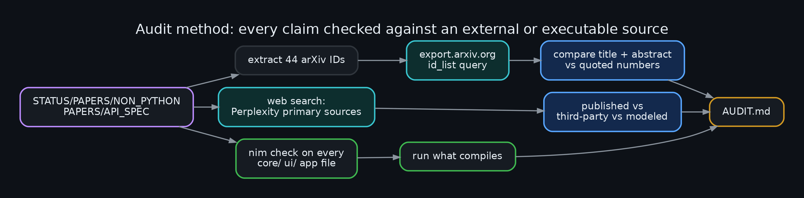

### Literature

All 44 distinct arXiv IDs the agent cited exist, so nothing was invented outright. But four IDs are attached to the
wrong paper, and several quoted numbers are contradicted by the papers' own abstracts.

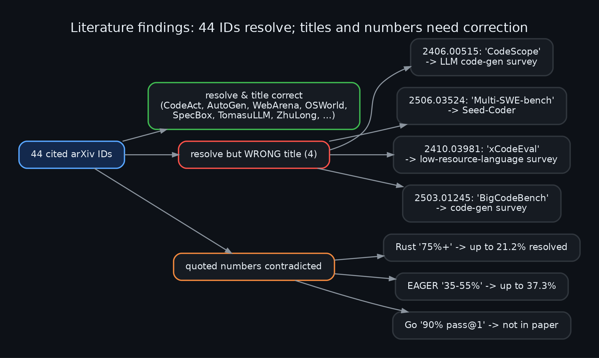

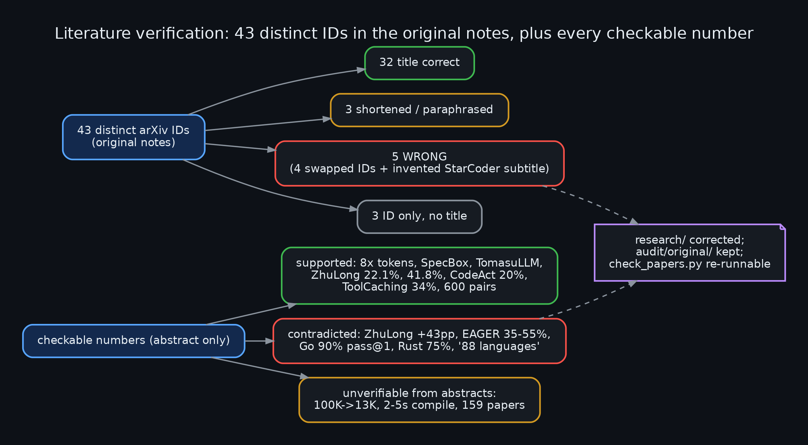

| Agent's claim | What the abstract says |
|---|---|
| `2406.00515` = "CodeScope" | A Survey on LLMs for Code Generation |
| `2506.03524` = "Multi-SWE-bench" | Seed-Coder |
| `2410.03981` = "xCodeEval" | Survey of code generation for low-resource/domain-specific languages |
| `2503.01245` = "BigCodeBench" | A code-generation survey |
| Rust "75%+ success" | agents resolve **up to 21.2%** of Rust-SWE-bench issues |
| EAGER latency "35–55%" | **up to 37.3%** end-to-end |
| Go "90%+ pass@1, 2.5K tasks" | study of ChatGPT writing 3 scientific programs; no such figures |

The five core sandbox papers (LLM-in-Sandbox, SpecBox, TomasuLLM, ZhuLong, EnterpriseBench) were summarized mostly accurately — with one error the first audit pass missed: ZhuLong's "+43 pp over static RAG" is wrong (78.5% vs 23.6% is against a pure-LLM baseline, a 54.9 pp gap). All 44 IDs and every checkable number are now in [`research/PAPER_VERIFICATION.md`](research/PAPER_VERIFICATION.md), regenerated by `audit/check_papers.py` (originals kept in `audit/original/`): of 43 distinct IDs in the original notes, 32 titles were right, 3 shortened, **5 wrong** (4 swapped IDs + an invented StarCoder subtitle), 3 had no usable title. Quoted numbers contradicted by abstracts: ZhuLong +43 pp, EAGER 35–55%, Go 90% pass@1, Rust 75%, "Multi-SWE-bench 88 languages" (actually 7).

### What Perplexity actually publishes

Primary source: Perplexity's own [Sandbox API post](https://hub-prod.perplexity.ai/hub/blog/sandbox-api-isolated-code-execution-for-ai-agents).
It states that Computer, Finance Agent and Deep Research run code in sandboxes; each session gets its own
**Kubernetes pod** with a persistent filesystem mounted via **FUSE**; the Sandbox API supports **Python, JavaScript
and SQL**; sandboxes have **no direct network by default**, and outbound traffic goes through an egress proxy outside the
sandbox that matches destination domains and injects credentials so code never sees raw keys.

Claims found only in third-party coverage — a "SPACE" runtime, Firecracker microVMs, ~125 ms boot, rolling snapshots — are
**unverified** and treated as such here.

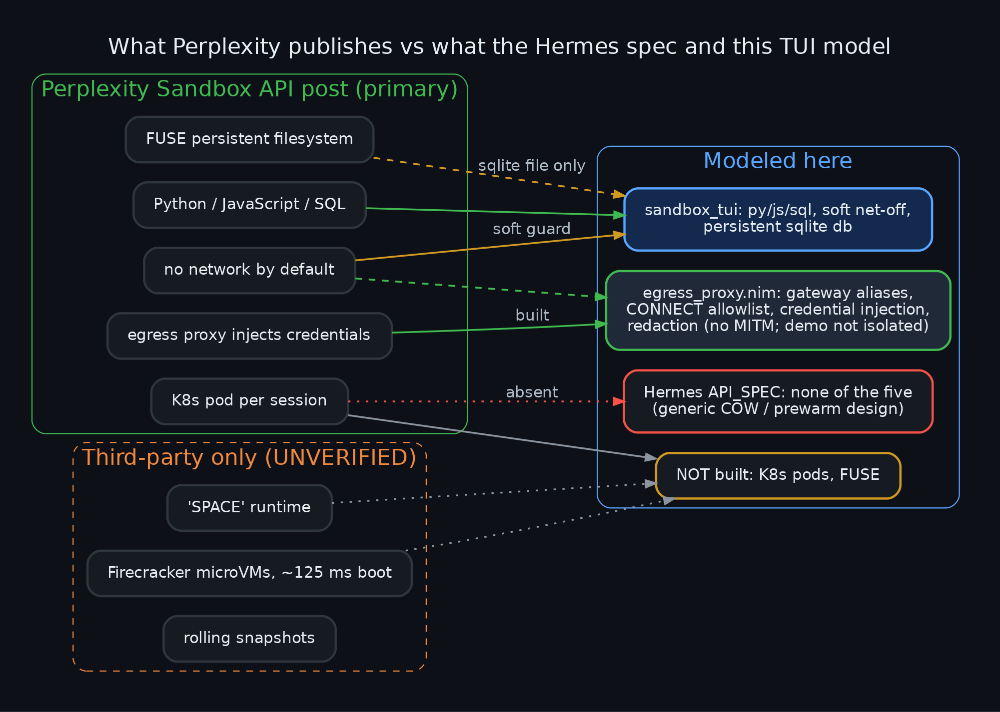

*Update:* the egress-proxy credential model is now implemented (see above); pods and FUSE are still not.

The agent's `API_SPEC.md` models none of the five published properties; it is a generic design built from SWE-agent/MCP/
speculative-execution papers. It is retitled accordingly in [`research/`](research/).

### The agent's code

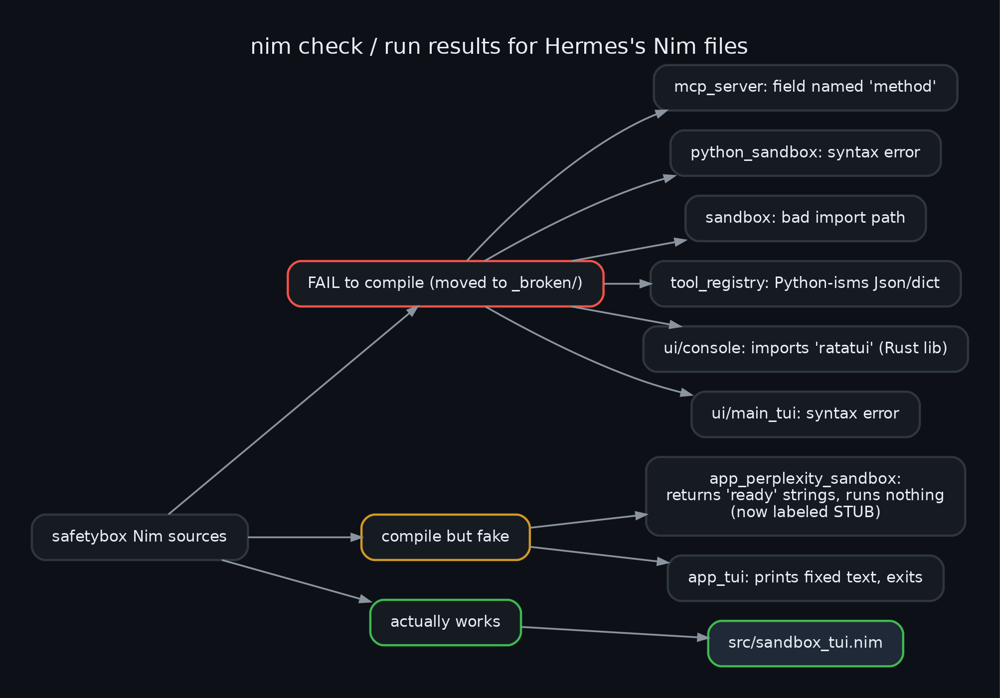

Six of the agent's Nim files failed `nim check`; the "complete, fully functional TUI" printed fixed text and exited
(its "Python execution ready" line was a literal string). Its next attempt still returned "Python ready" without running
anything. Only `src/sandbox_tui.nim` — written during the audit — runs code, and its behavior is covered by `tests/smoke.sh`.

## Where this was developed

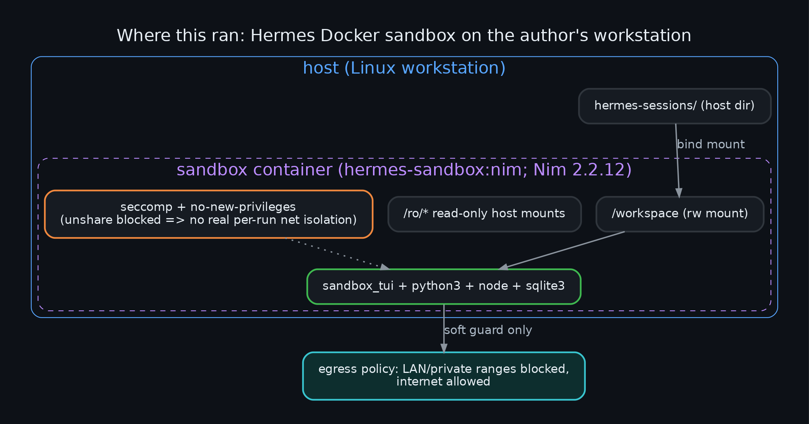

Inside the agent's Docker sandbox image (Nim 2.2.12, Python 3.11, Node 20, SQLite 3.46) on a Linux workstation, with LAN/private
ranges blocked at the network layer and a seccomp profile applied. The diagram is descriptive of that one environment, not a
requirement.

## Reproducing the audit

```bash
# arXiv IDs -> titles
curl -s "https://export.arxiv.org/api/query?id_list=2406.00515,2506.03524&max_results=10" | grep -E '<title>'
# diagrams
./render.sh
```

## Caveats

- Abstract-level verification only: papers were not read in full, and claims outside the abstracts remain unchecked.
- Web search results about Perplexity were read as of 2026-10-15; pages may change.
- The audited agent is a local LLM; its self-reports should be treated as claims to verify, not facts.

## License

MIT — see [LICENSE](LICENSE).
